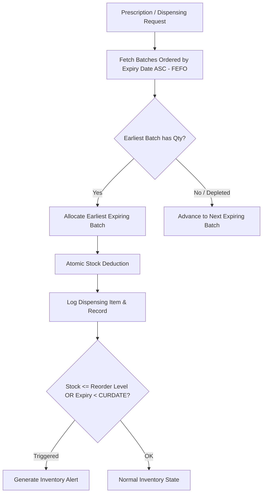
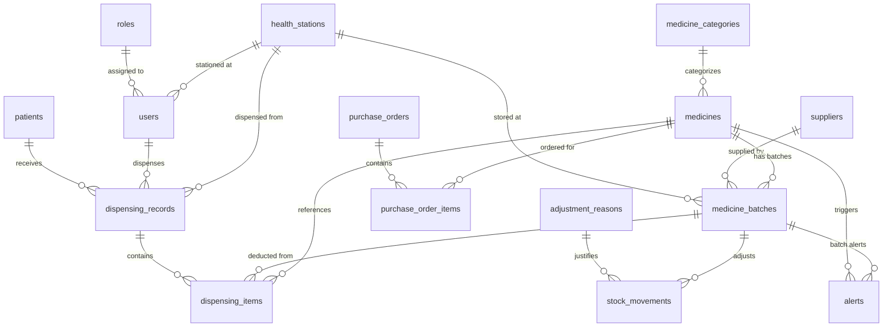

# MediTrac v2 — Barangay Health Center Medicine Inventory & Dispensing System

> **Courses:** Database Management Systems 1 (DBMS 1) & Systems Integration and Architecture (SIA)  
> **Curriculum Track:** Merged Track (Combined Database & Node.js MVC REST API Defense)  
> **Team:** Group 4, Section B  
> **Repository:** [https://github.com/Kuze-kun12/MediTrac](https://github.com/Kuze-kun12/MediTrac)

---

## 1. System Overview & Problem Statement

Public health stations and barangay clinics frequently face medicine wastage, expired stock distribution, and unrecorded inventory disbursements due to manual record-keeping. **MediTrac** is a centralized, role-based medicine inventory and dispensing management system built for municipal health units and barangay health sub-stations.

### Key Capabilities:
- **Role-Based Portals**: Tailored interfaces for Administrators, Pharmacists, and Barangay Health Workers.
- **Batch & Expiry Tracking**: Multi-batch inventory tracking per generic medicine with individual batch numbers and expiration dates.
- **Barangay Station Allocation**: Tracking and disbursement across multiple satellite health stations.
- **Audit & Dispensing Logs**: Comprehensive records tracking which health center and patient received each medicine batch.

---

## 2. Unique Major Feature: Automated FEFO & Safety-Stock Alert Engine

As required by Section 2 of the Project Guidelines, MediTrac moves beyond generic CRUD through an automated domain-specific workflow: **First-Expired, First-Out (FEFO) Batch Prioritization with Real-Time Expiry & Safety-Stock Alert Rules**.



### Self-Check Validation:
1. **Applies domain business rules?** Yes. Dispensing is governed by the FEFO algorithm, strictly allocating the nearest-expiring batches before newer stock.
2. **Automated actions?** Yes. The system automatically scans batch expiration dates and safety reorder thresholds on queries to dynamically trigger **Expired** and **Low Stock** alerts.
3. **Testable with tricky edge cases?** Yes. Tested when multiple batches exist for the same medicine across different health stations, and when a batch reaches zero quantity.
4. **Essential to the domain?** Yes. Removing this logic would convert the clinic safety system into an unmonitored generic table.

---

## 3. Architecture & File Structure

The project implements a **Layered MVC Architecture (Package-by-Layer)** with strict separation of concerns across the presentation, routing, application controller, and database access layers.

```
MediTrac v2/
├── backend/
│   ├── config/
│   │   └── db.js                 # MySQL connection pool configuration (mysql2/promise)
│   ├── controllers/
│   │   ├── authController.js     # Authentication, credentials verification, redirects
│   │   ├── dispensingController.js# Dispensing transactions, batch deductions, dispensing log
│   │   ├── medicineController.js # Medicine inventory CRUD, FEFO order, alerts
│   │   ├── patientController.js  # Patient registration and demographic records
│   │   └── stationController.js  # Barangay health station directory
│   ├── models/
│   │   ├── authModel.js          # User queries and role lookup
│   │   ├── dispensingModel.js    # Dispensing transactions, stock updates, log joins
│   │   ├── medicineModel.js      # Medicine queries, joins (INNER, LEFT, FULL OUTER), batch management
│   │   ├── patientModel.js       # Patient data access queries
│   │   └── stationModel.js       # Health station data queries
│   ├── routes/
│   │   ├── authRoutes.js         # POST /login
│   │   ├── dispensingRoutes.js   # GET & POST /api/dispensing-*
│   │   ├── medicineRoutes.js     # GET, POST, PUT, DELETE /api/data, /api/alerts, /api/fefo
│   │   ├── patientRoutes.js      # GET & POST /api/patients
│   │   └── stationRoutes.js      # GET /api/health-stations
│   ├── utils/
│   │   └── response.js           # Standard JSON response helpers: ok() and bad()
│   └── server.js                 # Express server bootstrap, static files & route registration
├── frontend/
│   ├── css/
│   │   └── style.css             # Shared responsive CSS design system
│   ├── dashboard.html            # Admin Portal: Inventory CRUD, alert monitoring, search
│   ├── healthworker.html         # Health Worker Portal: Read-only inventory & active warnings
│   ├── index.html                # Login Gateway & role-based routing
│   └── pharmacist.html           # Pharmacist Portal: Dispensing interface & distribution logs
├── utilities/
│   ├── git-semantic-push.sh      # Git helper script for semantic commit enforcement
│   └── usefull_utility.md        # Branching and Git guidelines
├── er_diagram.drawio             # Entity-Relationship diagram in draw.io format
├── query.sql                     # DDL Schema definitions (tables, constraints, foreign keys)
├── insert_table.sql              # Seed SQL data (roles, users, sample inventory, stations)
├── package.json                  # Node.js project manifest & dependencies
└── README.md                     # Comprehensive project documentation
```

### Architectural Layer Responsibilities:

* **Routing Layer (`routes/`)**: Maps incoming HTTP request verbs (`GET`, `POST`, `PUT`, `DELETE`) and URLs to controller handlers.
* **Controller Layer (`controllers/`)**: Normalizes request payloads, validates input formats, handles HTTP status codes (`200`, `201`, `400`, `401`, `500`), and forwards work to Models.
* **Model Layer (`models/`)**: Transport-agnostic data access layer running parameterized SQL queries, joins, and transactional database integrity checks.
* **View / Client Layer (`frontend/`)**: Static HTML5/CSS3/Vanilla JS consuming JSON APIs with dynamic DOM rendering and user feedback.

---

## 4. Group Roster & Section 5.4 Ownership Matrix

In compliance with **Section 5.4** of the project guidelines, each group member takes end-to-end ownership of a vertical slice (Database Tables, Model, Controller, Route, Frontend Screen, and SQL Join Report):

| Member | GitHub Username | Tables Owned | Endpoints / Screens | Join Report & Type | Feature Role |
| :--- | :--- | :--- | :--- | :--- | :--- |
| **Raul A. Generoso III** (Lead) | `Kuze-kun12` | `medicines`, `medicine_batches` | `GET /api/data`<br>`POST /api/data`<br>`PUT /api/data/:id`<br>`DELETE /api/data/:id`<br>`dashboard.html` | **FULL OUTER JOIN (Simulated)**:<br>Medicines and Batches with UNION | Core Inventory & Medicine CRUD |
| **Jero Erwin Lombrio** | `zezktokam69` | `dispensing_records`, `dispensing_items` | `GET /api/dispensing-records`<br>`POST /api/dispensing-records`<br>`pharmacist.html` | **INNER JOIN**:<br>Dispensing logs with batches and stations | Dispensing Transactions & Stock Deductions |
| **Xian Xavier C. Tinio** | `TinZ` | `alerts`, `adjustment_reasons`, `stock_movements` | `GET /api/alerts`<br>`GET /api/fefo`<br>`healthworker.html` | **LEFT JOIN**:<br>Medicines with missing batches / unstocked items | FEFO Algorithm & Stock Alert Engine |
| **Decirie Bulata** | `deciriebulata28` | `patients`, `health_stations` | `GET /api/patients`<br>`POST /api/patients`<br>`GET /api/health-stations`<br>`GET /api/reports/right-join` | **RIGHT JOIN**:<br>All Health Stations & stationed batches (showing unmatched as NULL) | Patient Records & Health Station Directory |
| **Fea Ann Villarba** | `feaann` | `users`, `roles`, `suppliers`, `medicine_categories` | `POST /login`<br>`GET /api/joined-medicines`<br>`index.html` | **INNER JOIN**:<br>Medicines joined with Categories & Suppliers | User Authentication & Master Lookup Data |

---

## 5. Database Design & SQL Join Reports (DBMS 1)

The database schema is normalized and contains **14 tables** (exceeding the 10+ table requirement for 5 members), with primary keys and foreign key constraints strictly enforced.



### Required SQL Join Implementations:

1. **INNER JOIN** (`GET /api/joined-medicines`):
   ```sql
   SELECT m.medicine_id, m.generic_name, m.strength, c.category_name AS category
   FROM medicines m
   INNER JOIN medicine_categories c ON c.category_id = m.category_id
   ORDER BY m.medicine_id;
   ```
2. **LEFT JOIN** (Checking medicines with no existing stock batch):
   ```sql
   SELECT m.medicine_id, m.generic_name, b.batch_id, b.batch_no
   FROM medicines m
   LEFT JOIN medicine_batches b ON b.medicine_id = m.medicine_id
   WHERE b.batch_id IS NULL
   ORDER BY m.medicine_id;
   ```
3. **FULL OUTER JOIN (Simulated via UNION for MySQL)**:
   ```sql
   SELECT m.medicine_id, m.generic_name, b.batch_no, b.expiry_date
   FROM medicines m
   LEFT JOIN medicine_batches b ON b.medicine_id = m.medicine_id
   UNION
   SELECT m.medicine_id, m.generic_name, b.batch_no, b.expiry_date
   FROM medicines m
   RIGHT JOIN medicine_batches b ON b.medicine_id = m.medicine_id
   ORDER BY medicine_id, batch_no;
   ```
4. **RIGHT JOIN** (`GET /api/reports/right-join`):
   ```sql
   SELECT hs.station_id, hs.station_name, hs.address, b.batch_no, m.generic_name, b.qty_on_hand
   FROM medicine_batches b
   RIGHT JOIN health_stations hs ON hs.station_id = b.station_id
   LEFT JOIN medicines m ON m.medicine_id = b.medicine_id
   ORDER BY hs.station_id ASC;
   ```

---

## 6. REST API Endpoints (SIA)

All API endpoints follow RESTful standards and return standardized JSON envelopes:
* **Success**: `{ success: true, ...data }`
* **Error**: `{ success: false, message: "..." }`

| Method | Endpoint | Description | Request Body | Status Codes |
| :--- | :--- | :--- | :--- | :--- |
| `POST` | `/login` | Authenticate user and return portal redirect | `{ username, password }` | `200`, `400`, `401`, `500` |
| `GET` | `/api/data` | Retrieve all medicines with category and active batch | _None_ | `200`, `500` |
| `POST` | `/api/data` | Create a new generic medicine and initial batch | `{ generic_name, batch_no, expiry_date, qty_on_hand, ... }` | `201`, `400`, `500` |
| `PUT` | `/api/data/:id` | Update medicine specifications and batch info | `{ generic_name, strength, dosage_form, unit, ... }` | `200`, `400`, `500` |
| `DELETE` | `/api/data/:id` | Cascading transactional deletion of medicine & records | _None_ | `200`, `400`, `500` |
| `GET` | `/api/alerts` | Get batches triggering expiry or reorder thresholds | _None_ | `200`, `500` |
| `GET` | `/api/fefo` | Get batch inventory prioritized by earliest expiry | _None_ | `200`, `500` |
| `GET` | `/api/patients` | Retrieve patient directory | _None_ | `200`, `500` |
| `POST` | `/api/patients` | Register new patient demographic record | `{ full_name, birthdate, purok, contact }` | `201`, `400`, `500` |
| `GET` | `/api/health-stations`| List registered barangay health units | _None_ | `200`, `500` |
| `GET` | `/api/dispensing-options`| Get health stations, registered patients & available batches | _None_ | `200`, `500` |
| `GET` | `/api/dispensing-records`| Retrieve recent patient & barangay dispensing log entries | _None_ | `200`, `500` |
| `POST` | `/api/dispensing-records`| Record distribution to patient/barangay and deduct batch stock | `{ station_id, batch_id, qty, patient_id, patient_name }` | `201`, `400`, `500` |
| `GET` | `/api/barangay-summary`| Summary of medicine distributions per barangay station | _None_ | `200`, `500` |
| `GET` | `/api/joined-medicines` | Report endpoint demonstrating INNER JOIN | _None_ | `200`, `500` |
| `GET` | `/api/reports/missing-batches` | Report endpoint demonstrating LEFT JOIN | _None_ | `200`, `500` |
| `GET` | `/api/reports/right-join` | Report endpoint demonstrating RIGHT JOIN | _None_ | `200`, `500` |
| `GET` | `/api/reports/full-outer-medicines` | Report endpoint demonstrating FULL OUTER JOIN (UNION) | _None_ | `200`, `500` |
| `DELETE` | `/api/data/:id` | Cascading transactional deletion of medicine & records | _None_ | `200`, `400`, `500` |
| `GET` | `/api/alerts` | Get batches triggering expiry or reorder thresholds | _None_ | `200`, `500` |
| `GET` | `/api/fefo` | Get batch inventory prioritized by earliest expiry | _None_ | `200`, `500` |
| `GET` | `/api/patients` | Retrieve patient directory | _None_ | `200`, `500` |
| `POST` | `/api/patients` | Register new patient demographic record | `{ full_name, birthdate, purok, contact }` | `201`, `400`, `500` |
| `GET` | `/api/health-stations`| List registered barangay health units | _None_ | `200`, `500` |
| `GET` | `/api/dispensing-options`| Get health stations & available batches with stock | _None_ | `200`, `500` |
| `GET` | `/api/dispensing-records`| Retrieve recent dispensing log entries | _None_ | `200`, `500` |
| `POST` | `/api/dispensing-records`| Record distribution to patient and deduct batch stock | `{ station_id, batch_id, qty, patient_name }` | `201`, `400`, `500` |
| `GET` | `/api/joined-medicines` | Report endpoint demonstrating INNER JOIN | _None_ | `200`, `500` |

---

## 7. Setup & Installation Guide

### Prerequisites
- **Node.js** (v18.0.0 or higher recommended)
- **MySQL Server** (v8.0 or MariaDB 10.4+)
- **Git**

### Step 1: Clone Repository
```bash
git clone https://github.com/Kuze-kun12/MediTrac.git
cd MediTrac
```

### Step 2: Install Node Dependencies
```bash
npm install
```

### Step 3: Database Setup
1. Open MySQL workbench, phpMyAdmin, or your terminal MySQL client:
   ```bash
   mysql -u root -p
   ```
2. Create the database:
   ```sql
   CREATE DATABASE Meditrac;
   USE Meditrac;
   ```
3. Import the table schema:
   ```bash
   mysql -u root -p Meditrac < query.sql
   ```
4. Import seed records and test data:
   ```bash
   mysql -u root -p Meditrac < insert_table.sql
   ```

### Step 4: Environment Configuration
Create a `.env` file in the root directory (based on `.env.example`):
```env
PORT=3000
DB_HOST=127.0.0.1
DB_PORT=3306
DB_USER=root
DB_PASSWORD=root
DB_NAME=Meditrac
```

### Step 5: Start the Server
```bash
npm start
```
The server will start at: `http://localhost:3000`

---

## 8. Seed Accounts for Defense Demo

The database includes pre-configured users with different access levels:

| Role | Username | Password | Default Redirect Page |
| :--- | :--- | :--- | :--- |
| **Administrator** | `admin_jane` | `pass123` | `/dashboard.html` |
| **Pharmacist** | `pharma_john` | `pass123` | `/pharmacist.html` |
| **Health Worker** | `worker_sarah` | `pass123` | `/healthworker.html` |

---

## 9. Git Workflow & Defense Guidelines

* **Main Protection**: No direct pushes to `main`. Every change is submitted via feature branches (`feature/<member>-<feature-name>`) and merged via Pull Request.
* **Semantic Commits**: All commit messages strictly follow conventional commits (`feat:`, `fix:`, `refactor:`, `docs:`, `chore:`).
* **Individual Code Defense**: Every member is prepared to walk through their owned tables, Models, Controllers, SQL joins, and live modify code on demand during the defense.
